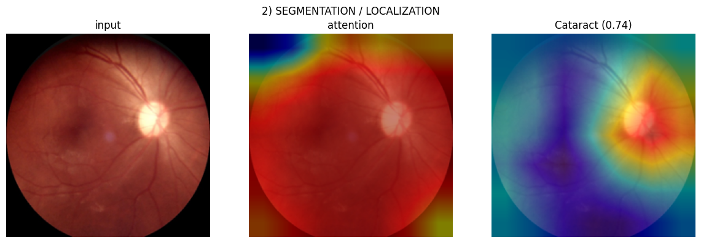
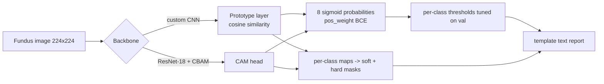
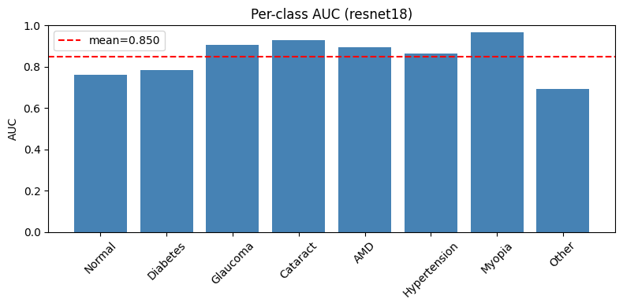

# Interpretable Multi-Label Eye Disease Diagnosis (ODIR-5K)


One forward pass over a colour fundus photo gives three outputs:

1. **eight independent disease probabilities** (Normal, Diabetes, Glaucoma, Cataract, AMD, Hypertension, Myopia, Other),
2. **a per-disease localisation map** (soft heat-map + hard mask),
3. **a short structured text report** naming each positive finding and the retinal region where the evidence was.

> **Course project** — Deep Learning, B.Tech CSE (AI), Amrita Vishwa Vidyapeetham, Coimbatore.
> Team: Sai Reddy A., Jithin Reddy K., Rohith Vardhan M., Sai Vandith Reddy.
> The prototype head is a simplified re-implementation of CIPL — Wang et al., *Cross- and Intra-image Prototypical Learning for Multi-label Disease Diagnosis and Interpretation*, IEEE TMI 2025 ([arXiv 2411.04607](https://arxiv.org/abs/2411.04607)).



## Problem

A single retinal image often carries several conditions at once, so screening is
multi-label. And a clinician shown eight probabilities has no way to know *which
part of the retina* drove each one. The brief also required one branch to use a
network **designed and trained from scratch** (no pretrained weights).

## Approach

Two branches share the same three-output head:

| Branch | Backbone | Head | Localisation |
|---|---|---|---|
| **From scratch** | custom 10-layer CNN (5 × [Conv-BN-ReLU ×2 + MaxPool]) | cosine-similarity prototypes, 10 per class (CIPL-style) | prototype similarity maps — every logit is computed from them |
| **Pretrained comparison** | ImageNet ResNet-18 | CBAM attention + 1×1 conv | class activation maps |

The pretrained branch exists to measure what the "from scratch" constraint costs.



## Results

ODIR-5K (Kaggle `andrewmvd/ocular-disease-recognition-odir5k`), 1,279-image
validation split, same split / seed / resolution for every row.

| ID | Backbone | Head | Imbalance handling | Epochs | mAUC | Macro-F1 |
|---|---|---|---|---:|---:|---:|
| C1 | ResNet-101 (pretrained) | Prototype | none (plain BCE, τ=0.5) | 5 | 0.705 | **0.000** |
| C2 | ResNet-101 (pretrained) | Prototype | pos_weight + tuned τ | 15 | 0.764 | 0.488 |
| C3 | Custom CNN (scratch) | Prototype | pos_weight + tuned τ | 30 | 0.707 | 0.370 |
| C5 | Custom CNN (scratch) | Prototype + soft/hard seg. | pos_weight + tuned τ | 30 | 0.703 | 0.383 |
| C6 | ResNet-18 (pretrained) | CBAM + CAM | pos_weight + tuned τ | 17 | 0.848 | 0.545 |
| **C7** | ResNet-18 (pretrained) | CBAM + CAM + WD + dropout | pos_weight + tuned τ | 30 | **0.850** | **0.576** |



What the table says:

* **Class imbalance handling mattered more than architecture.** Plain BCE (C1) collapses to predicting "no disease" for everything — 0.705 AUC but macro-F1 of exactly 0. Positive-class weighting plus per-class thresholds (C2) recovers 0.488 macro-F1 with no architectural change.
* **Pretraining is worth ~6–14 AUC points** on a dataset this size. The from-scratch prototype branch reaches ~0.70 mAUC.

### Caveats — read before quoting these numbers

* The notebook runs above used an **image-level** split and reported on the
  **validation** set that was also used for checkpoint selection. ODIR labels are
  per patient (two eyes), so that split can leak a patient across train and val.
  These numbers are optimistic.
* [`src/cipl_eye.py`](src/cipl_eye.py) fixes this — patient-level `GroupShuffleSplit`,
  train / val / test, thresholds tuned on val, numbers reported on test, multiple
  seeds — and also fixes a cosine-collapse bug in the original prototype head.
  **The full grid has not been re-run with it yet**, so there are no test-set numbers to report.
* Localisation is **weakly supervised**: ODIR has no pixel-level lesion masks, so the
  maps show where the model looked, not verified lesions. The example above highlights
  the optic disc for "Cataract", which is exactly the kind of thing these maps can get wrong.
* The text report is template-based, not generated.

## Repository layout

```
src/cipl_eye.py      unified harness: data loading, both branches, training,
                     threshold tuning, faithfulness / disentanglement metrics,
                     figures, LaTeX result tables (--run-all)
notebooks/
  01_prototype_branch_C1-C5.ipynb   Kaggle runs for C1-C5, outputs kept
  02_resnet18_cbam_C6-C7.ipynb      Kaggle runs for C6-C7, outputs kept
assets/              figures used in this README and the report
tests/test_smoke.py  one CPU epoch on synthetic images (runs in CI)
```

## Running it

Training was done on Kaggle GPUs. Attach the ODIR-5K dataset, then:

```bash
pip install -r requirements.txt
python src/cipl_eye.py --dataset odir --model custom_proto --epochs 30
python src/cipl_eye.py --run-all        # every model x seed, then LaTeX tables
```

`--model` is one of `custom_proto`, `custom_plain`, `resnet_cbam`. Use
`--data-root` if the dataset isn't auto-detected under `/kaggle/input`.

Smoke test (CPU, ~1 min, no dataset needed):

```bash
pip install pytest
python -m pytest tests -q
```

## What I'd do next

* Re-run the full grid with the patient-level protocol and replace the table above with test-set mean ± std.
* Evaluate localisation against a dataset that has lesion masks (IDRiD) — the hook is already in `evaluate_localisation_idrid`.
* Try the full CIPL objective (cross-image attention, push step) instead of the lite loss.

## Tech stack

Python · PyTorch · torchvision · scikit-learn · pandas · matplotlib · Kaggle GPUs
